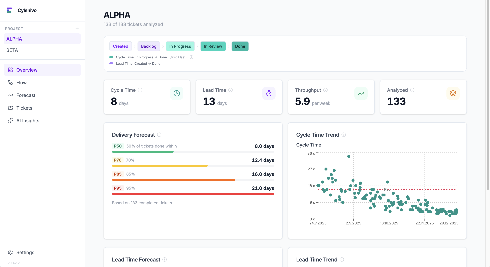

# Cylenivo

**[cylenivo.org](https://cylenivo.org)** — Download, screenshots and more.

Free desktop app to measure cycle time, lead time and throughput from Jira, Trello and OpenProject. Monte Carlo delivery forecasts, flow efficiency, rework detection. No cloud, no account — your data stays local.

Import your Jira export and instantly see **Cycle Time**, **Lead Time**, **Throughput**, and **Monte Carlo delivery forecasts**. All data stays on your machine.



## Features

- **Cycle Time & Lead Time** — percentile distributions (P50/P70/P85/P95) with trend charts
- **Throughput** — completed tickets per week
- **Delivery Forecast** — Monte Carlo simulation: "How many tickets in N weeks?" or "When will N tickets be done?"
- **Flow breakdown** — Time in Status, Cycle Time by ticket type, Rework analysis
- **Restarts** — a ticket moved back to the backlog after work started restarts its cycle time; aborted attempts are counted separately instead of turning into false outliers
- **Traceable numbers** — each ticket shows step by step how its cycle time and lead time were calculated
- **Time range or last N tickets** — filter every chart to a date range, or to the last 20/30/50/100 completed tickets
- **AI Insights** — connect your own Ollama or OpenAI-compatible model for narrative analysis
- **MCP server** — ask Claude Desktop, Cursor, LM Studio or VS Code about your metrics; read-only, runs locally
- **Multiple projects** — manage separate configs per team or workflow

## How it works

Cylenivo calculates metrics from **status transition timestamps**, not ticket fields. You configure which statuses mark the start and end of Cycle Time and Lead Time per project — no assumptions about your workflow.

## Data sources

| Source | Type | Notes |
|---|---|---|
| Jira | Built-in | Direct API connection (URL + API token) |
| OpenProject and Trello | Community plugin | Via [cylenivo-plugins](https://github.com/nobsagile/cylenivo-plugins) |
| Any tool | Community plugin | [Build your own](https://github.com/nobsagile/cylenivo-plugins/blob/main/CONTRIBUTING.md) in ~50 lines of JS |

Plugins are installed directly inside Cylenivo — no manual file management.

## Use it from your AI assistant (MCP)

Cylenivo ships an [MCP](https://modelcontextprotocol.io) server. Any MCP client can read your metrics and answer questions like *"Why did our cycle time go up in March?"*, *"Which tickets are stuck right now?"* or *"When will the next 20 tickets be done?"*.

**Setup:** Settings → AI → *Use Cylenivo from your AI assistant*. Pick your client, copy the snippet, paste it into the client's config file. Tested formats: Claude Desktop, Cursor, LM Studio, VS Code.

The client starts Cylenivo's server binary with `--mcp` on its own. The app does not need to be open.

| Tool | What it answers |
|---|---|
| `list_datasets` | Which teams/projects are imported |
| `get_flow_metrics` | Cycle time, lead time, throughput, time in status, flow efficiency |
| `get_rework` | How often tickets move backwards, and on which paths |
| `list_tickets` | Outliers by cycle time, or work in progress by age |
| `forecast` | Monte Carlo: when N tickets are done, or how many fit into N weeks |

All tools accept an optional dataset and a filter (`from`/`to` or `last` N tickets), the same as the app.

**Privacy:**
- Read-only. The database is opened read-only; no tool can change data.
- The tools never return Jira tokens or AI keys.
- Only stdio, no network port.
- Your metrics go to whatever model your client uses. With a local model (e.g. LM Studio) nothing leaves your computer.

## Getting started

→ **[Step-by-step guide: Your First Dataset from Jira, Trello, or OpenProject](https://cylenivo.org/guide)**

Download the latest release for macOS or Windows from the [Releases](https://github.com/nobsagile/cylenivo/releases) page.

> **Note:** Cylenivo is not code-signed. macOS and Windows will show a security warning on first launch — this is expected.
>
> **macOS:** Right-click the `.dmg` → Open, then right-click the app → Open. Or go to System Settings → Privacy & Security → "Open Anyway" after the first blocked attempt.
>
> **Windows:** Click "More info" → "Run anyway" when SmartScreen appears.

To analyze your Jira data:
1. Connect to Jira via API (URL + personal API token)
2. Create a configuration matching your workflow statuses
3. Import and explore

## Development

**Requirements:** Node 20+, [Bun](https://bun.sh), Rust (for Tauri)

```bash
npm install
cd server && bun install && cd ..
npm run tauri dev
```

Server tests:
```bash
cd server && npm test
```

Frontend tests:
```bash
npm test
```

## Further Reading

- [The physics behind software delivery flow](https://no-bullshit-agile.de/wip/) — interactive guide to Little's Law, Kingman's formula, and why WIP limits work
- [The Work-Feedback Loop](https://no-bullshit-agile.com/wfl/) — a framework for how work systems actually learn
- [Cylenivo: a tool, not a cockpit](https://no-bullshit-agile.com/cylenivo-a-tool-not-a-cockpit.html) — why metrics should trigger conversations, not control

## License

MIT + Commons Clause — free to use (including commercially), source-available.
Forks may not be sold or commercially redistributed. See [LICENSE](LICENSE) for details.

Copyright (c) 2026 Thomas Esders

Built by [Thomas Esders](https://no-bullshit-agile.com/contact.html)
